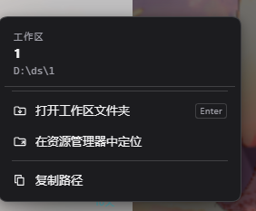

# dsh-open-workspace-folder

在 **DSH Desktop** 的工作区列表里右键任意工作区，直接打开对应的本地文件夹。



一个很小、无网络请求、无子进程的 DSH 客户端插件。它复用 DSH 自带的 Session Remote
`session.openWorkspacePath()`，所以 Windows 上用资源管理器、macOS 上用 Finder、
Linux 上用 `xdg-open` 打开路径，行为和 DSH 的「Open In」按钮一致。

## 功能

- **打开工作区文件夹**：在系统文件管理器中打开工作区根目录（回车键同样触发）。
- **在资源管理器中定位**：调用 `action: 'reveal'`，在文件管理器中定位该目录。
- **复制路径**：复制工作区绝对路径到剪贴板。
- 菜单跟随 DSH 主题（明/暗），支持 `Esc` 关闭、方向键导航、点击外部关闭。
- 所有图标为内联 SVG；无外部字体、图片、CDN 或网络请求。

## 安装

要求 DSH Desktop 已安装，且 `dsh` 命令在 `PATH` 中。

### 从本地克隆安装

```powershell
git clone https://github.com/Homeless-Attila/dsh-open-workspace-folder.git
dsh plugin --profile desktop add .\dsh-open-workspace-folder
```

### 直接从 GitHub 安装

```powershell
dsh plugin --profile desktop add github:Homeless-Attila/dsh-open-workspace-folder
```

这条命令会：

1. 把插件目录作为 `link:` 依赖（或 git 依赖）写进 desktop profile；
2. 因为包声明了 `dsh.bundle.patch`，自动把 `dsh-open-workspace-folder` 追加到
   `dsh.profile.bundles`；
3. 校验 bundle patch 可组合。

安装后需要**完全退出并重新启动 DSH Desktop**，让新的客户端 bundle 加载。

> 目前尚未发布到 npm。发布后即可直接
> `dsh plugin --profile desktop add dsh-open-workspace-folder`。
> 如果以 `link:` 方式安装，移动插件目录后需要重新执行一次 `add <新路径>`。

## 使用

1. 在左侧工作区树中找到一个工作区。
2. 右键该工作区行。
3. 选择「打开工作区文件夹」。

如果当前 DSH 运行在普通浏览器里、宿主端不允许打开本地路径，菜单会显示
「当前窗口不支持打开本地文件夹」，复制路径仍然可用。

## 卸载

```powershell
dsh plugin --profile desktop remove dsh-open-workspace-folder
```

然后重启 DSH Desktop。

## 结构

```text
dsh-open-workspace-folder/
  package.json        # dsh.bundle.patch + dsh.client (platform: web)
  cordis.patch.yml    # 挂载一行 host 插件
  index.js            # host half：空实现，不注册路由、不启动进程
  client.js           # 全部功能：右键菜单 + Session Remote
  docs/preview.png    # 右键菜单截图
  README.md
  LICENSE
```

## 实现要点

- `client.js` 是一个标准 DSH 客户端 bundle：
  `window.__ModuleLoader__.load({ id, factory })`，React 从模块表 `require('react')` 取得。
- 通过 `ctx.get('slots')` 向 `shell.overlay` 注册一个菜单组件；
  组件从 `shell.overlay` 的 `useWorkspaces` 属性订阅工作区快照。
- 捕获阶段监听 `contextmenu`，只处理带 `data-row-key="workspace:<id>"` 和
  `aria-expanded` 的工作区 `treeitem`；会话行（带 `aria-selected`）和
  `data-row-key="workspace:"` 的「未分组」伪工作区会被忽略。
  通过 `span[class$="_title"]` 的文本兜底匹配实时工作区列表，拿到 `workspace.path`。
- 打开动作使用宿主已有的 Session Remote：

  ```js
  const remote = ctx.get('remote')
  await remote.session.openWorkspacePath({ path })
  await remote.session.openWorkspacePath({ path, action: 'reveal' })
  ```

  不需要 host RPC，也不需要自己拼 `explorer.exe` 命令行。
- 客户端模块额外导出 Cordis 服务注入：

  ```js
  exports.inject = ['remote', 'remote.session']
  ```

  注意它和 `package.json` 里的 `dsh.client.inject`（模块依赖图）是两套机制，
  只配置后者时运行时仍会报
  `cannot get property "remote.session" without inject`。

## 已知限制

- 桌面端没有客户端 HMR 插槽，安装或改代码后必须**完全重启 DSH Desktop**；
  仅刷新窗口不够。
- 菜单依赖工作区行的 DOM 结构（`data-row-key` / `aria-expanded`）。DSH 前端若改动
  这些标记，需要同步调整 `client.js`。

## 开发校验

```powershell
node --check client.js
node --check index.js
```

开发时另做过一轮隔离测试页验证（菜单注册、定位/打开/复制、`Esc` 关闭、会话行忽略、
「未分组」忽略、宿主不允许打开时禁用打开项等），并在独立 desktop profile Web 运行时
按 1440×900 实测右键、打开、定位与复制路径，均无报错。

## License

[MIT](LICENSE)
